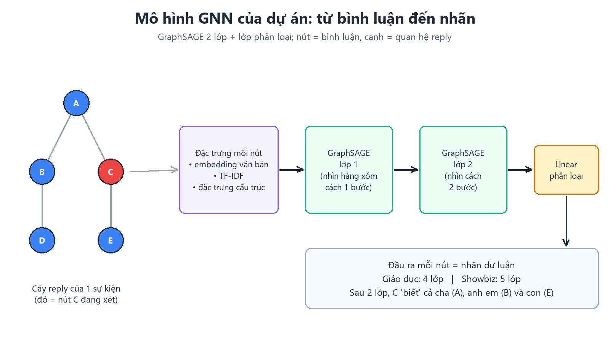
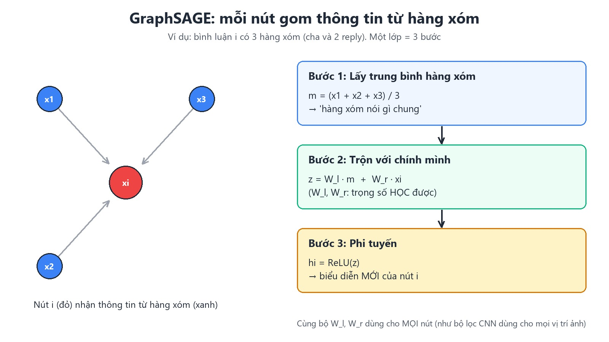
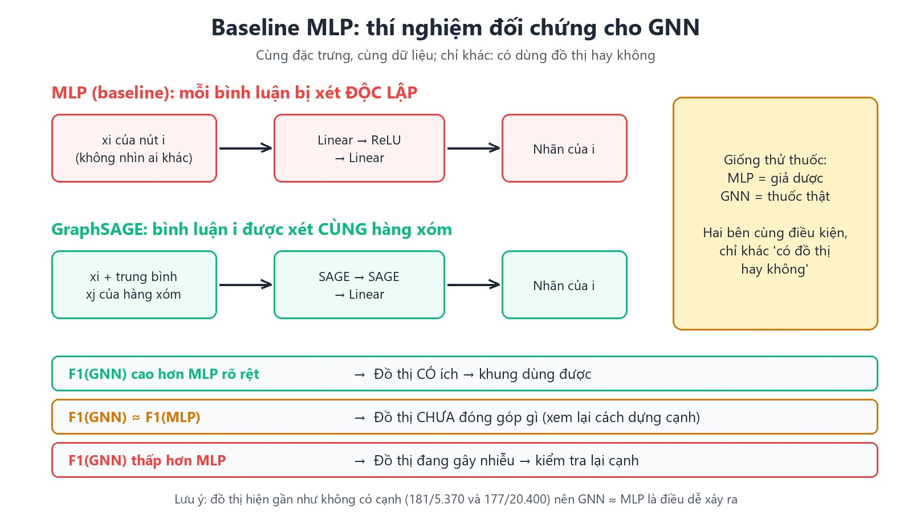

# Khung GNN, Neo4j và fine-tune PhoBERT (chuẩn bị chờ dữ liệu gán lại)

Cập nhật: 2026-11-07. Bản nháp, chờ user duyệt. Plan: `plans/261107-1817-gnn-neo4j-phobert-finetune-frame/plan.md`.
Bổ sung cho [mo-hinh-ml-va-phan-tich.md](./mo-hinh-ml-va-phan-tich.md) (mô tả bản cũ). Test dùng dữ liệu tổng hợp hoặc nhãn LLM hiện có để kiểm khung; **số F1 trong tài liệu này không phải chất lượng mô hình** vì nhãn gold đang được team gán lại.

Môi trường local: `py -3.14` (có torch CPU). Chạy test từ gốc repo: `py -3.14 -m pytest ml/gnn/tests ml/phobert/tests -q` (15 test đạt, 2026-11-12; chạy riêng từng thư mục `ml/gnn/tests` và `ml/phobert/tests` vì chạy chung bị lỗi import pandas trên Python 3.14).

## 1. GNN (`ml/gnn/`)

| Bước | Lệnh | Ghi chú |
|---|---|---|
| Dựng graph | `python ml/gnn/build_discussion_graph.py --domain all` | không đổi |
| Embedding API | `python ml/gnn/extract_api_embeddings.py --domain education` | `embedding_api_client.py`: Gemini `gemini-embedding-001`, 768 chiều, cache SQLite `data/gnn/embedding_cache.sqlite`, batch, retry, xoay khoá. Đổi model: `--model/--dim` |
| TF-IDF | `python ml/gnn/extract_tfidf_features.py` | không đổi |
| Ghép đặc trưng | `python ml/gnn/concat_node_features.py --text-emb api` (hoặc `phobert`) | chiều lấy từ dữ liệu; embedding chuẩn hoá L2, cấu trúc `log1p` (xem mục 4) |
| Train | `python ml/gnn/train_gnn_node_classification.py --domain education --split event --out-dir <dir>` | `--split event`: nguyên sự kiện vào một tập; `--out-dir` tránh ghi đè `data/gnn/metrics_*.json` cũ; `--model {sage,mlp}`: GraphSAGE hoặc baseline MLP (không dùng cạnh, cùng split/loss/seed) |

`model_graphsage_classifier.py`: dùng PyG `SAGEConv` nếu có, không thì `MeanSAGEConv` thuần torch (cùng tên tham số `lin_l/lin_r`, checkpoint nạp chéo được). `make_model` nhận `in_dim` theo đặc trưng thật và `kind` (`sage`/`mlp`). `MLPClassifier`: Linear-ReLU-Dropout-Linear-ReLU-Linear, bỏ qua `edge_index`.

Minh hoạ:   

## 2. Neo4j (`ml/gnn/graph_db/`)

- Mô hình: `(Event)`, `(Comment {uid=event::comment_id, text, label, depth, in_degree, sibling_count, pred_label, pred_conf, split})`, `(Label)`; cạnh `IN_EVENT`, `REPLY_TO`, `HAS_LABEL`. Ràng buộc/chỉ mục: `schema.cypher`. Truy vấn mẫu: `sample_queries.cypher`.
- Nạp (idempotent): `NEO4J_PASSWORD=... python ml/gnn/graph_db/load_graph_to_neo4j.py --init-schema --domain all`; thêm `--predictions <predictions_x.json>` để gắn dự đoán GNN (chỉ một domain/lần); `--wipe-domain` để nạp lại sạch.
- **Docker Desktop không chạy được trên máy dev** (WSL hỏng: `REGDB_E_CLASSNOTREG`, cần quyền admin để sửa); đã bỏ `docker-compose.yml`. Cách đã kiểm chứng: Neo4j Community 5.26 bản Windows tại `D:\tools\neo4j-community-5.26.0` + JDK 17 (`D:\jdk\jdk-17.0.13+11`): `neo4j.bat console`, Bolt `localhost:7687`. Mật khẩu local đặt bằng `neo4j-admin dbms set-initial-password`; không commit.
- Đã nạp thử 2026-11-07: 49 sự kiện, 23.821 nút `Comment`, 358 cạnh `REPLY_TO`.

## 3. PhoBERT fine-tune (`ml/phobert/`)

Entry `phobert_finetune_colab.py`; module: `phobert_config` (nhãn, **tên cột**, siêu tham số), `phobert_data` (đọc xlsx/csv, chuẩn hoá nhãn, chia tập), `phobert_segmenter`, `phobert_model`, `phobert_train`; `phobert-batch-inference.py`; notebook mỏng `phobert-finetune-colab.ipynb`.

- Khi có dữ liệu: `python phobert_finetune_colab.py --domain showbiz --data_path labeled_showbiz_final.csv` (thêm `--eval_file` cho tập đánh giá đóng băng). Dữ liệu đổi cấu trúc: truyền `--text-col`, `--verified-label-col`... hoặc sửa `phobert_config.py`.
- Quy tắc nhãn: `verified_label` thắng (kể cả khi `is_trash=True`); mặc định `--label_source verified_or_llm` (dùng toàn bộ dữ liệu: thiếu `verified_label` thì rơi về `is_trash`/nhãn LLM). `verified` chỉ dùng dòng người đã sửa; các dòng này là chỗ LLM sai nên lệch phân bố, không dùng làm tập train duy nhất. Dữ liệu: `labeling data/labeled_{education,showbiz}_final.csv` (đã bỏ dòng trống/`comment_id` trùng, có cột `final_label`/`label_source`). Nhãn gõ sai/viết khác (`Ứng hộ`, `rác`...) được chuẩn hoá qua `LABEL_ALIASES`; nhãn lạ bị loại và thống kê ra log.
- Chia tập mặc định theo sự kiện (không rò rỉ giữa tập), thử 300 hoán vị sự kiện có seed và chọn cách chia có phân bố nhãn gần toàn bộ nhất, val/test ≥3 sự kiện; lưu `split_manifest.json`. Tách từ bằng `underthesea` (PhoBERT cần văn bản đã tách từ); segmenter lưu trong `config.json` và inference dùng lại. Thiếu thư viện thì báo lỗi, không âm thầm hạ cấp.
- Sửa so với bản cũ: luôn có `best_model.pt` (trước đây có thể thiếu nếu val F1 = 0), pad động theo batch, AMP trên GPU, inference dùng cấu hình lúc train.
- `--smoke`: encoder nhỏ ngẫu nhiên để kiểm pipeline. Đã chạy trên `verify_education_5k_dedup.xlsx` (label_source `verified_or_llm`): chạy hết train → test → batch inference; F1 vô nghĩa (mô hình ngẫu nhiên). **Chưa fine-tune PhoBERT thật, chưa tải trọng số 540MB.**

## 4. Kết quả kiểm khung và phát hiện

1. **Đồ thị gần như không có cạnh:** Giáo dục 181 cạnh/5.370 nút, Showbiz 177/20.400. GNN gần như thành MLP trên đặc trưng nút, nên lợi thế "đồ thị" chưa chứng minh được với dữ liệu hiện tại; cần dữ liệu có `parent_comment_id` (crawler FB mới).
2. **Quota Gemini free tier:** chỉ embed được ~940 văn bản (≈1.000 lượt/ngày) rồi bị chặn; Giáo dục cần 5.370, Showbiz 20.400. Khung kiểm trên 4 sự kiện Giáo dục (551 nút): chạy hết build → embed → TF-IDF → concat → train (cả split `node` và `event`) → predictions → Neo4j. F1 trên tập nhỏ này vô nghĩa thống kê. Muốn embed đủ: bật billing, hoặc dùng PhoBERT gốc làm đặc trưng, hoặc chạy nhiều ngày (cache giữ tiến độ).
3. **Lỗi thang đo đã sửa:** đặc trưng cấu trúc thô (hàng trăm) át embedding (~0,01) khiến mô hình không học (loss gần như đứng yên); nay chuẩn hoá. Đặc trưng ghép mới không tương thích số đo cũ trong `data/gnn/metrics_*.json`.
4. **ID trùng:** 39/551 nút trùng `(event_id, comment_id)` trong subset, và Neo4j 23.821 nút so với 25.770 nút graph (≈1.949 bị gộp). Loader cảnh báo; cần dữ liệu có ID duy nhất khi chuẩn hoá lại.
5. Chia nút (`node`) rò rỉ giữa các sự kiện; `event` nghiêm ngặt hơn nhưng với ít sự kiện cho tập test rất nhỏ.

6. **So SAGE với MLP (2026-11-12, 551 nút / 4 sự kiện Giáo dục, đặc trưng Gemini 768 + TF-IDF 300 + 3, 5 seed):** bộ con này có **0 cạnh**, nên SAGE chỉ còn nhánh `lin_r` (≈ MLP một lớp). F1-macro trung bình test: `--split event` SAGE 0,380 / MLP 0,351 (n_test dao động 16–326 theo seed); `--split node` SAGE 0,525 / MLP 0,539 (n_test 83). Chênh lệch nằm trong nhiễu giữa các seed → đồ thị chưa đóng góp được gì; kết quả chỉ xác nhận khung chạy đủ chuỗi cho cả hai mô hình, không phải chất lượng.

## 5. Còn lại / câu hỏi mở
- Cấu trúc dữ liệu gán lại (user sẽ chuẩn hoá); hiện chỉ có 106 dòng Giáo dục và 68 dòng Showbiz có `verified_label` trong file dedup.
- Chọn model embedding cuối (API trả phí / PhoBERT gốc / PhoBERT fine-tune) và có đưa `is_trash` vào GNN không.
- Chạy fine-tune thật trên Colab sau khi có dữ liệu; chưa đo thời gian/độ chính xác.
