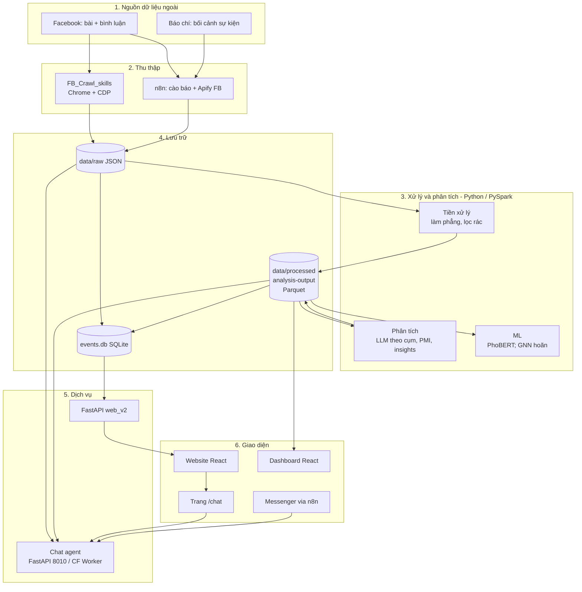
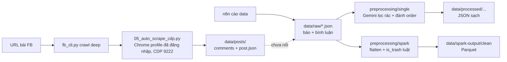
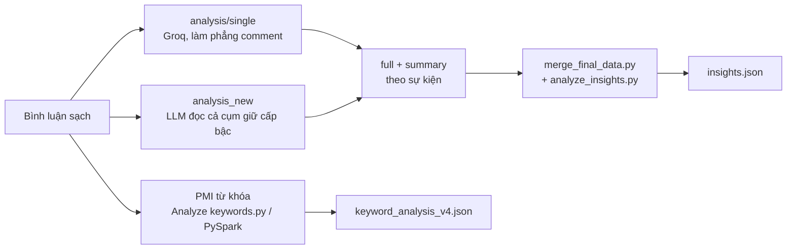
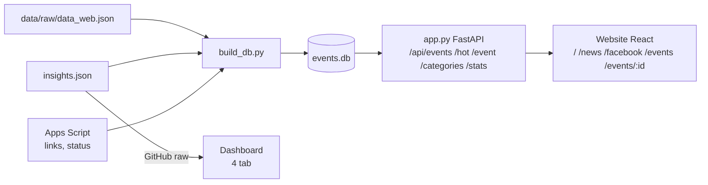
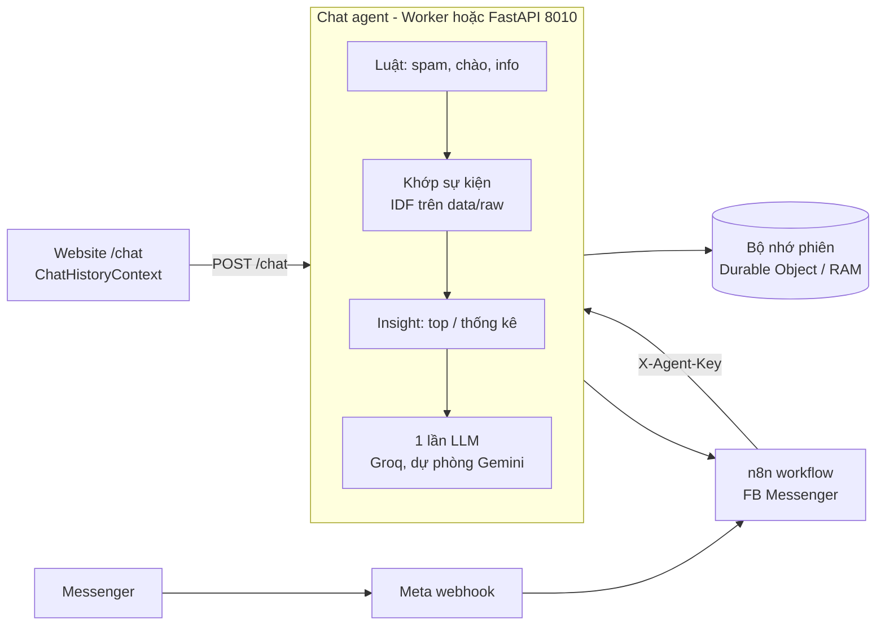
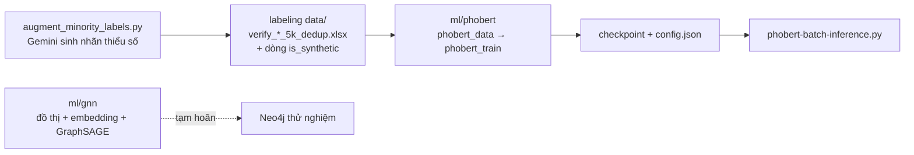

# Kiến trúc tổng thể

Document loại 1/16 (xem `docs/doc-map.md`). Cập nhật: 2026-11-19. **Bản nháp chờ user đọc và sửa.**

Tổ chức 2 lớp (user giao 2026-10-31):
- **Lớp 1 – tổng thể** (mục 1–2): nâng cấp từ Hình 1.1 (trang 16 `NCKH_Word.pdf`, báo cáo 05/2026), sửa theo code hiện tại.
- **Lớp 2 – cụ thể** (mục 3): bốn sơ đồ chi tiết (thu thập + xử lý, phân tích, phục vụ web, chatbot, ML), mỗi sơ đồ trỏ tới document sâu hơn.

Phạm vi: chỉ mô tả cái đang có (nguyên tắc ở `doc-map.md`). Hạng mục làm sau nằm ở bảng "Việc làm sau" của `doc-map.md`. Cách đọc code từng thư mục: `docs/huong-dan-doc-code-tung-thu-muc.md`.

---

## 1. Lớp 1 – Tổng thể

### 1.1 Mục tiêu

**Drama Intelligence** thu thập, xử lý, phân tích và phục vụ dữ liệu dư luận mạng xã hội Việt Nam về hai lĩnh vực **Showbiz** và **Giáo dục** (đề tài NCKH cấp trường). Phục vụ hai việc: (1) người ít theo dõi mạng xã hội hỏi nhanh về một sự kiện; (2) nhà quản lý / nhóm nghiên cứu xem phản ứng dư luận dạng thống kê.

Nguyên tắc: giao diện tách khỏi xử lý AI (API-first); dữ liệu 3 tầng thô → đã xử lý → tương tác; hai bản pipeline (Python đơn luồng, PySpark) để đối chiếu; chatbot chỉ trả lời theo dữ liệu truy xuất được.

### 1.2 Sơ đồ tổng thể

So với Hình 1.1 của báo cáo, ba chỗ đã đổi theo code: lớp API là **FastAPI + SQLite** (không phải Node.js); chatbot là **agent riêng** (FastAPI cục bộ hoặc Cloudflare Worker) thay cho agent RAG trong n8n; n8n chỉ còn làm thu thập và cầu nối Messenger.

### 1.3 Sáu khối

| Khối | Vai trò | Thành phần chính | Chi tiết |
|---|---|---|---|
| 1. Nguồn ngoài | Dữ liệu dư luận và bối cảnh | Facebook, báo chí | loại 4 |
| 2. Thu thập | Lấy dữ liệu về dạng JSON | `FB_Crawl_skills/`, n8n (`ingestion/n8n/cào data.json`) | loại 4 |
| 3. Xử lý / phân tích | Làm sạch, gán nhãn, thống kê, mô hình | `preprocessing/`, `analysis/`, `analysis_new/`, `ml/` | loại 2, 5, 6 |
| 4. Lưu trữ | Ba tầng dữ liệu (mục 4) | `data/`, `events.db` | loại 3 |
| 5. Dịch vụ | API sự kiện và agent chat | `serving/web_v2/backend/`, `serving/chat_agent/`, `serving/chat_agent_worker/` | loại 7, 9, 10 |
| 6. Giao diện | Web, chat, dashboard, Messenger | `serving/web_v2/frontend/`, `serving/dashboard/` | loại 15 |

### 1.4 Vai trò người dùng

| Vai trò | Dùng gì | Mục đích |
|---|---|---|
| Người dùng đại chúng | Chatbot (web, Messenger), website | Hỏi diễn biến và dư luận một sự kiện, đọc tin tổng hợp |
| Nhà quản lý / cơ quan (nhất là Giáo dục) | Dashboard, chatbot | Xem phân bố cảm xúc, từ khóa, sự kiện nổi bật |
| Nhóm nghiên cứu / quản trị | Dashboard, dòng lệnh, n8n | Thu thập, phân tích, giám sát chất lượng dữ liệu |

Chưa có đăng nhập hay phân quyền (API chỉ có GET, CORS mở `*`: `serving/web_v2/backend/app.py:24-29`).

---

## 2. Công nghệ

| Nhóm | Công nghệ |
|---|---|
| Ngôn ngữ | Python 3.11–3.14 (tùy môi trường), JavaScript/TypeScript |
| Thu thập | Chrome + CDP (`FB_Crawl_skills`), n8n, SerpApi, Firecrawl, Apify, Google Sheets/Drive |
| LLM | API mmodiary (`analysis_new`), Groq / Gemini (chat agent, bản cũ `analysis/single`) |
| NLP / ML | underthesea, PMI + n-gram, PhoBERT, PyTorch (GraphSAGE, tạm hoãn) |
| Xử lý dữ liệu | pandas, Parquet, PySpark 3.5 (local mode) |
| Backend | FastAPI, SQLite, Uvicorn; Cloudflare Worker + Durable Object (agent) |
| Frontend | React 19 + Vite (website: Router 7, Ant Design, SASS; dashboard: TypeScript, Recharts) |
| Đồ thị | Neo4j Community 5.26 chạy thủ công (thử nghiệm, không phải phụ thuộc của web/agent) |

Phiên bản chính xác: `serving/web_v2/backend/requirements.txt`, các `package.json`.

---

## 3. Lớp 2 – Cụ thể

### 3.1 Thu thập và tiền xử lý

- Hai nhánh tiền xử lý làm cùng việc; `verify_preprocessing.py` đối chiếu kết quả.
- Dữ liệu `FB_Crawl_skills` chưa được nối vào pipeline xử lý (còn thiếu theo `PROJECT_STATE.md`).
- Chi tiết: `docs/thu-thap-du-lieu.md`, `docs/data-pipeline.md`.

### 3.2 Phân tích

- `analysis_new/` là hướng 1 trong `docs/mo-hinh-ml-va-phan-tich.md`: gom bình luận cấp 1 + reply thành cụm, một request LLM đọc nhiều cụm (tối đa 60 comment), trả nhãn từng comment và `summary` mỗi cụm; summary giữ khóa mà `analyze_insights.py` đọc.
- Hai bản chạy (đơn luồng, PySpark) dùng chung các module ở `analysis_new/`.
- Đã chạy thật 1 sự kiện (`showbiz_068`); chưa nối kết quả mới vào `insights.json`.

### 3.3 Phục vụ web

`build_db.py` xóa và dựng lại hai bảng `events`, `actors`. Dashboard đọc JSON qua GitHub raw, có dữ liệu fallback. Chi tiết: `docs/backend-serving.md`, `docs/hop-dong-tich-hop.md`.

### 3.4 Chatbot

- Một tin nhắn qua tối đa một lần LLM; luật và khớp sự kiện chạy trong bộ nhớ, không dùng Supabase/embedding (quyết định 2026-11-05).
- Web gọi theo `VITE_CHAT_API_URL`; Worker chỉ cho web (Origin cho phép) gọi không khóa, nơi khác phải gửi `X-Agent-Key`.
- Agent n8n cũ (Dispatcher + Supabase) không còn trên đường web; workflow `FB Messenger -> local chat agent` đang là cầu nối Messenger. Chi tiết: `docs/llm-agent-rag.md` mục 8b–8d.

### 3.5 ML

- PhoBERT: code sẵn sàng, chưa fine-tune thật (cần Colab/GPU); code đọc cột `label`, dòng `is_synthetic` chỉ vào train (2026-11-21).
- GNN: tạm hoãn (user chốt 2026-11-12, 2026-11-16); dữ liệu gán nhãn hiện không có cấu trúc reply. Chi tiết: `docs/mo-hinh-ml-va-phan-tich.md`, `docs/khung-gnn-neo4j-phobert.md`.

---

## 4. Dữ liệu thuộc về ai

| Tầng | Nội dung | Nơi nằm | Ai tạo |
|---|---|---|---|
| 1. Thô | JSON báo chí, bình luận FB | `data/raw/`, `FB_Crawl_skills/data/posts/` | n8n; crawler |
| 2. Đã xử lý | Bình luận phẳng đã lọc rác, nhãn; Parquet | `data/processed/`, `data/spark-output/clean/`, `data/analysis-new-output/` | Pipeline Python / Spark |
| 2'. Tổng hợp | `insights.json`, `keyword_analysis_v4.json` | `data/analysis-output/` | `analysis/` |
| 2''. Phục vụ web | `events.db` | `serving/web_v2/backend/` | `build_db.py` |
| 3. Tương tác | Câu hỏi và trả lời | `history.json`, `QA.json` (gốc repo); phiên chat 30 phút trong agent (Durable Object / RAM) | Agent n8n cũ ghi `history.json`; agent hiện tại chỉ giữ phiên, không ghi file |

Bình luận Facebook là nội dung của người thật; vấn đề pháp lý và quyền riêng tư: loại 12.

## 5. Chỗ lệch giữa báo cáo / document cũ và code

Code là source of truth; document cũ giữ nguyên nhưng cần biết các điểm sau.

| # | Báo cáo / document cũ nói | Code thật | Bằng chứng |
|---|---|---|---|
| 1 | Backend là Google Apps Script + Google Sheets; hoặc Node.js/Express + MongoDB | FastAPI + SQLite; Apps Script chỉ là nguồn phụ `links`, `status` khi build DB | `build_db.py`, `app.py`, `requirements.txt` |
| 2 | Hình 1.1: lớp API Node.js; chatbot là agent RAG trong n8n + Supabase | Agent chat riêng (FastAPI/Worker), khớp sự kiện trong RAM; n8n chỉ cầu nối Messenger | `serving/chat_agent*/`; `DECISIONS.md` 2026-11-05/06 |
| 3 | Dashboard lấy `insights.json` tại `analysis-ouput` trên GitHub | Code dùng `ouput`, thư mục local là `analysis-output`; chưa xác minh nguồn remote | `App.tsx:17` |
| 4 | Cổng backend 8000 (`api.js`, docstring `app.py`) | README chạy cổng 8001 và đặt `VITE_API_BASE` | `serving/web_v2/README.md` |
| 5 | `README.md` gốc: `serving/code_web/`, `ingestion/cao_fb/` | Thư mục thật `serving/web_v2/`; crawler FB là `FB_Crawl_skills/` | `ls` |
| 6 | Dispatcher 3 nhánh (`branch_firecrawl`) | Prompt local chỉ 2 nhánh; luồng n8n cloud không còn trên đường web | `docs/prompts/agent đầu tien.md` |

## 6. Câu hỏi mở

1. File `insights.json` trên GitHub mà dashboard đọc có tồn tại và đang dùng không (repo chỉ có bản ở `data/analysis-output/`)?
2. Dữ liệu Supabase (workflow Embedding) còn dùng cho việc gì sau khi agent bỏ Supabase?
3. Dashboard chính thức chạy ở đâu: bản trong repo hay AI Studio?
4. Khi nào nối dữ liệu `FB_Crawl_skills` và kết quả `analysis_new` vào `insights.json` / `events.db`?
