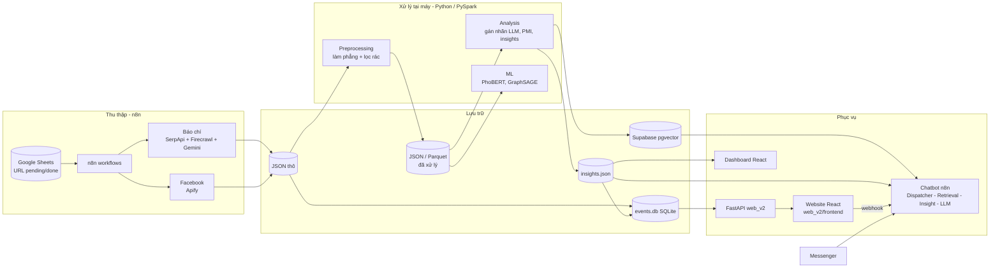

# Kiến trúc tổng thể

Document loại 1/16 (xem `docs/doc-map.md`). Cập nhật: 2026-10-29. **Bản nháp chờ user đọc và sửa.**

Phạm vi: chỉ mô tả những gì đang có trong dự án (xem nguyên tắc ở `docs/doc-map.md`). Hạng mục dự định làm sau nằm ở bảng "Việc làm sau" trong `doc-map.md`, chưa viết vào đây.
Chi tiết từng phần nằm ở document khác (pipeline: loại 2; dữ liệu: loại 3; RAG: loại 7; API: loại 9, 10).

---

## 1. Mục tiêu và nguyên tắc

**Drama Intelligence System** thu thập, xử lý, phân tích và phục vụ dữ liệu dư luận mạng xã hội Việt Nam về hai lĩnh vực: **Showbiz** và **Giáo dục**. Đây là đề tài NCKH cấp trường (báo cáo 05/2026).

Hệ thống phục vụ hai việc:
1. Cho người ít theo dõi mạng xã hội hỏi nhanh về một sự kiện (diễn biến, nhân vật, mức độ quan tâm, dư luận).
2. Cho nhà quản lý / nhóm nghiên cứu xem phản ứng dư luận dạng thống kê (cảm xúc, từ khóa, sự kiện nổi bật).

Nguyên tắc thiết kế:
- Kiến trúc 3 lớp, API-first: giao diện tách khỏi xử lý AI/RAG.
- n8n là bộ điều phối workflow, không phải web server.
- Dữ liệu 3 tầng: thô → đã xử lý → tương tác (mục 5).
- Hai bản pipeline (Python đơn luồng và PySpark) cho cùng kết quả để đối chiếu.
- Chống ảo giác: chỉ trả lời theo dữ liệu truy xuất được; không có thì tra cứu web hoặc từ chối.

## 2. Vai trò người dùng

| Vai trò | Dùng gì | Mục đích |
|---|---|---|
| Người dùng đại chúng | Chatbot (web, Messenger), website báo | Hỏi diễn biến và dư luận một sự kiện, đọc tin tổng hợp |
| Nhà quản lý / cơ quan (đặc biệt Giáo dục) | Dashboard, chatbot | Xem phân bố cảm xúc, từ khóa, sự kiện nổi bật |
| Nhóm nghiên cứu / quản trị | Dashboard, chạy pipeline bằng dòng lệnh, n8n | Thu thập, phân tích, giám sát chất lượng dữ liệu |

Chưa có đăng nhập hay phân quyền trong code (API chỉ có GET, CORS mở `*`: `serving/web_v2/backend/app.py:24-29`).

## 3. Thành phần và trách nhiệm

### 3.1 Sơ đồ tổng quan

Sơ đồ rút gọn các mũi tên nhỏ (ví dụ `build_db.py` còn lấy `links`, `status` từ Apps Script). Chi tiết ở loại 2 và 3.

### 3.2 Thành phần

| Lớp | Thành phần | Vị trí | Trách nhiệm |
|---|---|---|---|
| Thu thập | n8n workflows | n8n cloud; bản export `ingestion/n8n/cào data.json` | Đọc Google Sheets, tìm URL (SerpApi), cào báo (Firecrawl), tổng hợp (Gemini), cào bình luận Facebook (Apify), ghi JSON lên Google Drive, đổi trạng thái `pending → done` |
| Thu thập (FB) | Scraper Facebook | `ingestion/code_cao_fb_chuahoanthien/` | Bản làm lại, chưa hoàn thiện (xem mục 6) |
| Tiền xử lý | Python đơn luồng | `preprocessing/single/` | Chuẩn hóa, sắp lại thứ tự, lọc rác |
| Tiền xử lý | PySpark | `preprocessing/spark/` | Cùng việc trên, đối chiếu với bản đơn luồng |
| Phân tích | Python | `analysis/single/` | Gán nhãn cảm xúc/lập trường bằng LLM (hai bước), PMI + n-gram, `analyze_insights.py` → `insights.json` |
| Phân tích | PySpark | `analysis/spark/` | PMI từ khóa |
| ML | GraphSAGE | `ml/gnn/` | Phân loại nút trên đồ thị thảo luận (kết quả hiện chưa đạt) |
| ML | PhoBERT | `ml/phobert/` | Fine-tune/suy luận (kết quả hiện chưa đạt) |
| Lấy mẫu / nhãn | Scripts và file kiểm | `sampling_labeling/` | Lấy mẫu phân tầng, xuất file kiểm duyệt cho gold set |
| Benchmark | Scripts | `benchmark/` | So sánh Python và Spark |
| Dữ liệu web | ETL | `serving/web_v2/backend/build_db.py` | Gộp `data/raw/data_web.json`, `insights.json`, Apps Script → `events.db` |
| API | FastAPI | `serving/web_v2/backend/app.py` | 5 endpoint GET đọc `events.db` |
| Website | React | `serving/web_v2/frontend/` | Trang chủ, tin tức, Facebook; nhúng chatbot |
| Dashboard | React + TypeScript | `serving/dashboard/` | 4 tab: Overview, Sentiment, Interaction, System |
| Chatbot | Multi-agent RAG | n8n cloud | Dispatcher → Retrieval (2 luồng) / Insight Analyst → Final LLM |
| Vector DB | Supabase pgvector | Supabase | Lưu embedding chunk sự kiện (education, showbiz) |

### 3.3 Chatbot

Luồng trả lời một câu hỏi (chi tiết ở loại 7):
1. Website gọi webhook n8n `…/webhook/nckh` (`Chatbot.jsx:46`), hoặc người dùng nhắn qua Messenger.
2. **Dispatcher** (Gemini Flash) đọc câu hỏi, trả JSON định tuyến: chào hỏi / tra cứu DB / (tra cứu web).
3. **Retrieval Agent** tìm top chunk trong Supabase (education và showbiz chạy song song), rerank.
   **Insight Analyst** đọc `insights.json` cho câu hỏi số liệu.
4. **Final LLM** (Groq, Llama) tổng hợp câu trả lời từ ngữ cảnh đã lọc.
5. Không có dữ liệu: Firecrawl tra cứu web; câu hỏi thiếu dữ liệu ghi vào Google Sheets để bổ sung sau.

## 4. Công nghệ

| Nhóm | Công nghệ |
|---|---|
| Ngôn ngữ | Python 3.11, JavaScript/TypeScript |
| Điều phối | n8n (cloud) |
| Thu thập | SerpApi, Firecrawl, Apify (+ proxy), Google Sheets/Drive |
| LLM | Gemini 2.5 Flash (Dispatcher, gán nhãn, tổng hợp), Groq/Llama (câu trả lời cuối) |
| RAG | Supabase (pgvector), Gemini embedding, Cohere rerank |
| NLP / ML | underthesea, PMI + n-gram, TF-IDF, PhoBERT, PyTorch + PyG (GraphSAGE) |
| Xử lý dữ liệu | pandas, PyArrow/Parquet, PySpark 3.5 (local mode; factory hiện đặt mặc định JDK 17 + winutils trên Windows) |
| Backend | FastAPI 0.115, Uvicorn, SQLite, httpx, BeautifulSoup |
| Frontend (web) | React 19, Vite, React Router 7, Ant Design 6, SASS |
| Frontend (dashboard) | React, Vite, TypeScript |

Phiên bản chính xác: `serving/web_v2/backend/requirements.txt`, `serving/web_v2/frontend/package.json`.

## 5. Dữ liệu thuộc về ai

| Tầng | Nội dung | Nơi nằm | Ai tạo / sở hữu |
|---|---|---|---|
| 1. Thô | JSON từ n8n (báo chí, bình luận FB) | `data/raw/`, Google Drive | n8n; nhóm nghiên cứu |
| 2. Đã xử lý | Bình luận phẳng đã lọc rác, có nhãn; Parquet | `data/processed/`, `data/spark-output/clean/` | Pipeline Python / Spark |
| 2'. Tổng hợp | `insights.json`, `keyword_analysis_v4.json` | `data/analysis-output/` | `analysis/` |
| 2''. Phục vụ web | `events.db` | `serving/web_v2/backend/` | `build_db.py` |
| Vector | Chunk + embedding | Supabase | n8n (nạp từ JSON đã xử lý) |
| 3. Tương tác | Câu hỏi và trả lời chatbot | `history.json`, `QA.json` (gốc repo) | Chatbot / n8n |

Bình luận Facebook là nội dung của người thật; vấn đề pháp lý và quyền riêng tư xem loại 12.

## 6. Cấu trúc trang

**Website** (`serving/web_v2/frontend/src/App.jsx:15-17`)

| Route | Trang | Dữ liệu |
|---|---|---|
| `/` | HomePage | `/api/hot`, `/api/events`, `/api/categories` |
| `/news` | NewsPage | `/api/events` |
| `/facebook` | FacebookPage | `/api/events` |

Lưu ý: `getPaginatedPosts` (`services/api.js`) bỏ qua tham số nền tảng và mọi sự kiện trong `events.db` đều có `platform = news`, nên hai trang `/news` và `/facebook` hiện hiển thị cùng một tập 85 sự kiện (chi tiết: loại 3, mục 10).
| (mọi trang) | Chatbot (component) | webhook n8n |

**Dashboard** (`serving/dashboard/src/App.tsx`): tab Overview (`OverviewView`), Sentiment (`SentimentView`), Interaction (`InteractionView`), System (`SystemView`). Đọc JSON qua `raw.githubusercontent.com` (xem mục 7).

## 7. Chỗ lệch giữa báo cáo / document cũ và code

Code là source of truth. Các document cũ giữ nguyên, nhưng khi đọc phải biết các điểm sau:

| # | Báo cáo hoặc document cũ nói | Code thật | Bằng chứng |
|---|---|---|---|
| 1 | Backend web là Google Apps Script + Google Sheets (báo cáo 3.2.1.3.3) | FastAPI + SQLite. Apps Script chỉ còn là nguồn phụ lấy `links`, `status` khi build DB | `build_db.py:3-5, 41-60`; `app.py` |
| 2 | Backend Node.js/Express + MongoDB (`thông tin về dự án.docx`) | Không có Node backend hay MongoDB trong repo | `serving/web_v2/backend/requirements.txt` |
| 3 | Dashboard hiển thị trên AI Studio | Có bản React trong repo, và vẫn trỏ AI Studio trong README | `serving/dashboard/README.md` |
| 4 | Dashboard lấy `insights.json` tại `main/data/insights.json` trên GitHub | File trong repo ở `data/analysis-output/insights.json`, không có `data/insights.json` | `App.tsx:17`; `ls data/` |
| 5 | Cổng backend 8000 (mặc định `api.js:1`, docstring `app.py:3`) | README hướng dẫn chạy cổng 8001 và đặt `VITE_API_BASE` | `serving/web_v2/README.md` |
| 6 | Dispatcher có 3 nhánh gồm `branch_firecrawl` (báo cáo ch.3) | `docs/prompts/agent đầu tien.md` chỉ có 2 nhánh (`branch_greeting`, `branch_database`) | Hai file prompt |
| 7 | `README.md` gốc: `serving/code_web/`, `ingestion/cao_fb/` | Thư mục thực là `serving/web_v2/`; `ingestion/cao_fb/` đã xóa khỏi working tree | `ls serving ingestion` |

Mục 4, 6 cần user xác nhận phiên bản nào đang chạy thật (file trên GitHub, workflow trên n8n cloud); tôi không kiểm tra được từ repo.

## 8. Hiện trạng

### Tình trạng hiện tại (khoảng 85% theo đánh giá nội bộ)
- Chạy được: thu thập qua n8n, tiền xử lý, phân tích, chatbot RAG, website, dashboard. Dữ liệu: 85 sự kiện (40 Giáo dục, 45 Showbiz), trong đó 50 sự kiện đã có phân tích bình luận (20 + 30) theo `insights.json`.
- Ba script Spark đang import đường dẫn cũ `data.spark...` nên không chạy trực tiếp được sau khi dời thư mục (loại 2, mục 6).
- Chưa đạt / còn lỗi: nhãn LLM nhiễu và mất cân bằng; GraphSAGE và PhoBERT chưa đạt mục tiêu (sẽ làm lại); báo cáo cũ ghi dữ liệu Showbiz trong RAG chưa cập nhật (prompt Dispatcher local hiện không ghi giới hạn này; runtime chưa xác minh, xem loại 7); phụ thuộc gói miễn phí (lỗi 429, n8n free mất kết nối).
- Đang làm lại: luồng cào Facebook (`ingestion/code_cao_fb_chuahoanthien/`), Phase 01 PySpark.

Hạng mục dự định làm sau (chưa có plan cụ thể): xem bảng "Việc làm sau" trong `docs/doc-map.md`. Khi bắt đầu từng hạng mục, document này được viết lại.

## 9. Câu hỏi mở

1. File `insights.json` trên GitHub (`main/data/insights.json`) có tồn tại và đang được dùng cho dashboard không? Trong repo chỉ có bản ở `data/analysis-output/`.
2. Dispatcher đang chạy trên n8n cloud là bản 2 nhánh hay 3 nhánh (có `branch_firecrawl`)?
3. Dữ liệu trong Supabase hiện nạp từ file nào, và có gồm Showbiz mới không?
4. Dashboard chính thức chạy ở đâu: bản trong repo hay AI Studio?
